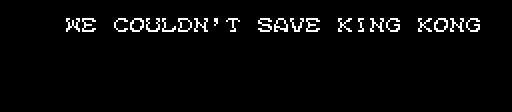
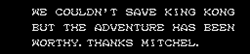
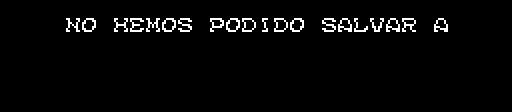
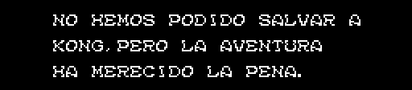

# The patch

A one-byte fix for the King Kong 2 translation by **Imanok, Manuel Pazos and Ramones** ([KING KONG 2 ULTIMATE TRANSLATION](https://msxblue.com/imanok/), 2012-2013), into English and Spanish. It is not for the Japanese cartridge: it goes on after their patch.

- [KK2DSKEN_final.ips](parches/KK2DSKEN_final.ips), after `KK2DSKEN.ips` (English).
- [KK2DSKES_final.ips](parches/KK2DSKES_final.ips), after `KK2DSKES.ips` (Spanish).

## What it does

It fixes the text of ending 0, the one you get when you finish the game with 366 days or more (`p06:A845`): the scene where KING KONG could not be saved. On the Japanese cartridge it is three lines. With the translation, the text stops after the first one and a few seconds later THE END comes up. With the fix, all three show, as in the original.

**English**, without the fix and with it:

**Spanish**, without the fix and with it:

*Drawn from the ROM with `tools/arreglo_final.py`, as `p06:AADD` draws it; each image is identical, pixel by pixel, to the openMSX screen (`tools/lanza_final.sh`).*

## Why

The text is written letter by letter by `p06:AADD`: 0xFE moves to the next line (it adds the byte after it to x and goes down 16 pixels) and 0xFF ends it. In the translation, between the first and the second line there is a 0xFF where a 0xFE should be. The routine stops there, and the rest of the text, which is still in the ROM, is never read.

The byte that follows gives it away: it is exactly what has to be added to x to get back to the start of the line, at x 0x20.

| | The first line | After the 0xFF | x |
|---|---|---|---|
| English, `0xCDFF` | WE COULDN'T SAVE KING KONG (26 letters) | 0x30 | 0x20 + 26 × 8 + 0x30 = 0x120: 0x20 |
| Spanish, `0xCE11` | NO HEMOS PODIDO SALVAR A (24 letters) | 0x40 | 0x20 + 24 × 8 + 0x40 = 0x120: 0x20 |

The fix turns that 0xFF into 0xFE, and nothing else.

## How to apply it

1. To the Japanese cartridge, Imanok's patch (`KK2DSKEN.ips` or `KK2DSKES.ips`, from [their page](https://msxblue.com/imanok/)).
2. On top, the one from here for the same language.

An IPS does not check what it is applied to. `tools/arreglo_final.py` first checks that the 0xFF is there, with the first line before it and the 0x30 or 0x40 after it, and stops if not.

## Checked

- In openMSX, ending 0 on the Japanese cartridge and on both patches, with and without the fix: without it, the text pointer stays on the 0xFF; with it, it reaches the end of the third line.
- In the conversations of both patches there is no other text cut short like this: every line is followed by another line or by a pointer list.
- Every text in the game, with the patches' translation, in [The texts](THE-TEXTS.md).
