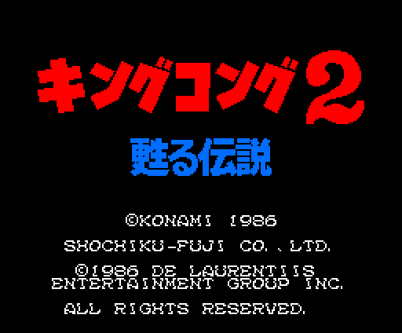
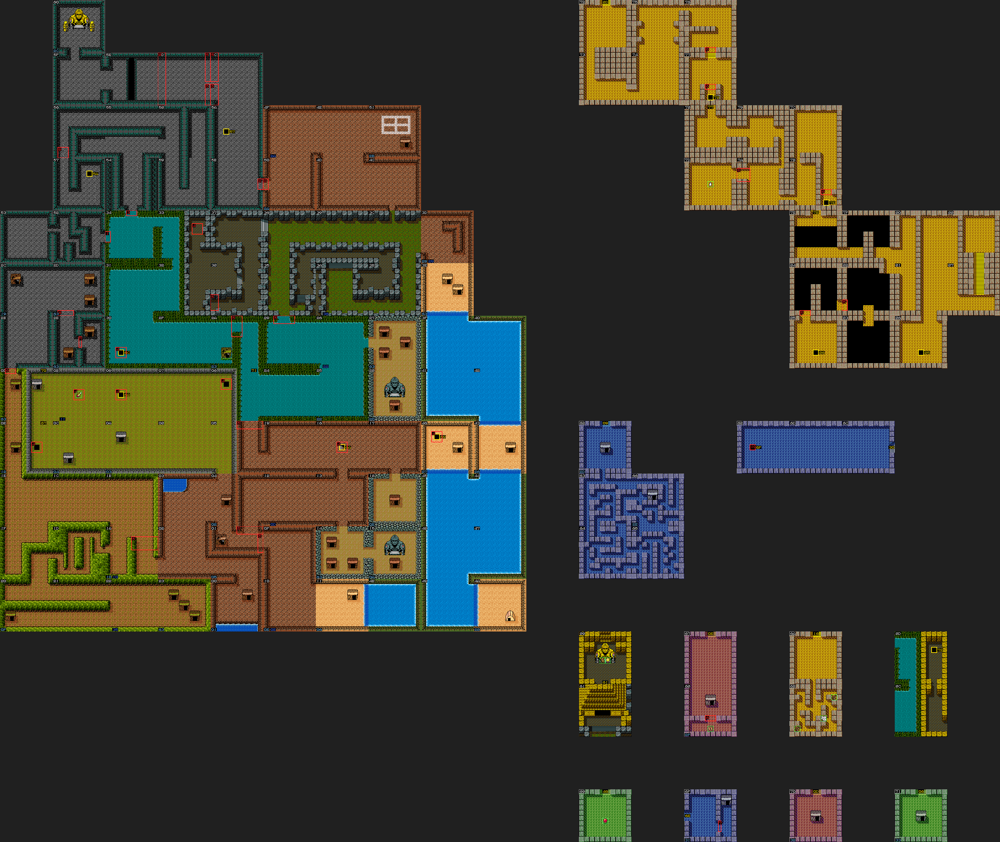
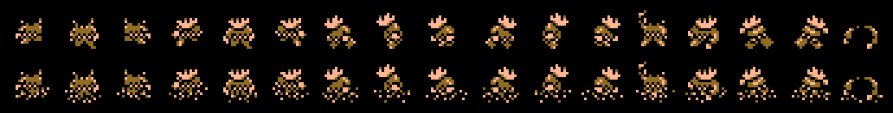
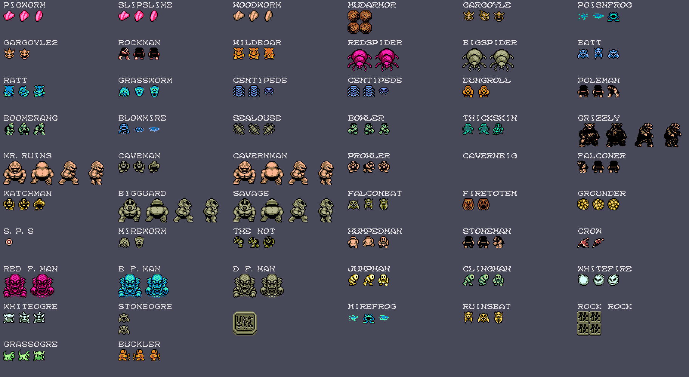
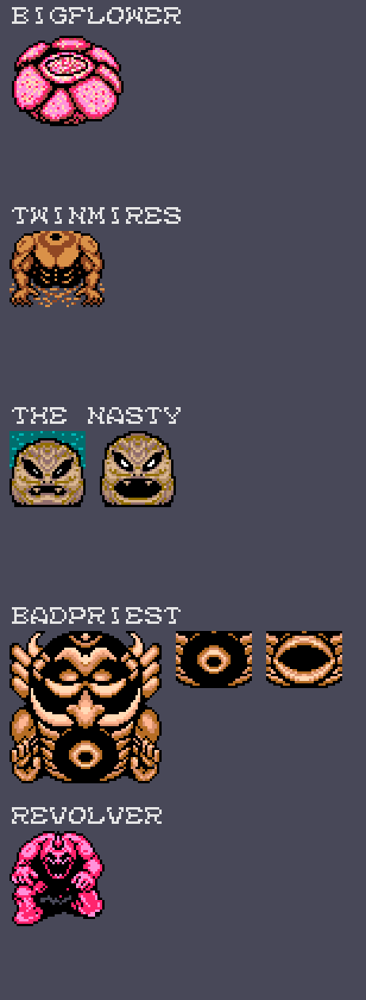
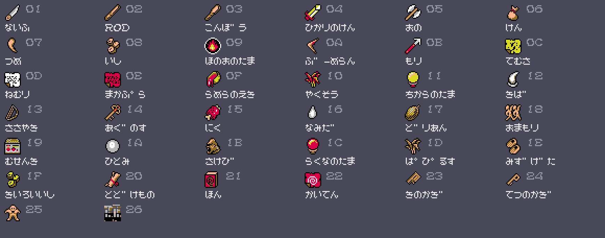

# El juego

Mitchel busca a **LADY KONG** por una isla: KING KONG se muere y solo ella
puede salvarle. Por la radio le mete prisa el ejército («¿Aún no habéis
encontrado a LADY KONG? Si no os dais prisa, KING KONG morirá»), y por la
isla hay gente que habla, tiendas, zonas de dentro y 55 clases de enemigos
con nombre, más cinco jefes que no son sprites.

Todas las imágenes de esta página están **dibujadas desde los bytes de la
ROM** con las herramientas de `tools/`, que siguen los pasos del propio
cartucho. Debajo de cada una se dice de qué tabla sale y cómo se ha cotejado
contra openMSX (MSX2, `C-BIOS_MSX2_JP`).

## La pantalla de título

El rótulo キングコング2 甦る伝説 son letras de 1 bit (p06:A2A1, A3C1 y A561)
que p00:4867 sube a la página 1 en dos colores; la paleta sube de tono en tres
fases (p06:B9C8). Antes, el logotipo de Konami se destapa. Los dos, cotejados
contra openMSX: **0 puntos distintos** y los mismos 16 colores.

## La isla

Son **140 pantallas** que se ven enteras, sin desplazamiento: 97 en la isla
y el resto en once zonas de dentro. Cada pantalla
dice cuáles son sus cuatro vecinas (p09:B1C5); montarlas así da el mapa, y el
orden de las salidas está comprobado en openMSX sacando a Mitchel por los
bordes. 0xF0-0xFB son salidas especiales (p01:611F) que llevan a otra
pantalla y a un punto concreto.

Encima, sacado de las tablas:

- **en amarillo**, los 15 pasadizos (p06:BE16: casillas 0xC0-0xC3) y las
  salidas especiales, con la pantalla a la que llevan;
- **en rojo**, las 37 cosas de decorado que se pueden quitar (p09:B3FD), con
  el número del suceso que las quita: el 4 es el conjuro てむさ, que quita
  rocas; varios pasadizos están debajo;
- **en verde**, los objetos que aparecen solos al entrar (p06:BB57) y la
  espada de luz de la pantalla 0x0B;
- **en azul**, la conversación que salta al pararse en la pantalla
  (p12:A5FE), y en azul oscuro la de quien aparece al matar a un enemigo
  (p01:7EF5).

## El panel

A la derecha: MITCHEL, **DAYS** (un día cada 2048 cuadros), **LIFE** (se
empieza con 30; la máxima es 30 + 16 × LEVEL), **EXP** (hasta 9999),
**LEVEL** (uno más cada 100 de EXP, hasta 99), **MP**, **GOLD** (se empieza
con 200), y lo que se lleva en **SHOT1** (el arma) y **SHOT2** (el objeto).
Todo en BCD.

## Mitchel

Diecisiete poses (0xC310) en dos juegos: fuera del agua y dentro, con las
piernas tapadas (0xC160). Cada pose es un RLE (p13:7D9B y p13:7DBD) que da
dos patrones de 16 × 16: uno en color 1 y otro con el bit CC puesto, que suma
su color al de debajo.

## Los enemigos

Cada pantalla trae su lista (p13:6000: [tipo][x][y]); el bit 7 del tipo dice
que solo sale en el plano alterno. El nombre que se ve en el panel al pegarle
es el de p15:BA76. Los cuadros de cada enemigo son los que se grabaron en
openMSX pantalla a pantalla; sus patrones y colores salen de la ROM.

Un enemigo muerto no vuelve mientras Mitchel siga en las 3 × 3 pantallas de
alrededor (0xDF00, p00:590B), y un jefe muerto no vuelve nunca (0xDE00).

## Los jefes que no son sprites

BIGFLOWER, TWINMIRES, THE NASTY, BADPRIEST y REVOLVER son dibujos que
p00:4BD0 sube tal cual a la página 1 al entrar en su pantalla (las figuras de
p14; algunas, dos veces, la segunda en espejo). El VDP los copia a la página 0
con LMMM cada vez que cambian: la boca de THE NASTY y BADPRIEST, cerrada y
abierta. Cotejado contra openMSX: **0 bytes distintos** en sus siete
pantallas.

## Los objetos y las armas

38 dibujos de 16 × 16 (p07:630A) que p00:4AED sube a la página 1. Los
nombres son los de p15:A069, en la fuente del juego. Del 0x01 al 0x0B (y el
0x1F) van a **SHOT1**, las armas; los demás, a **SHOT2** (p01:7A35).

El daño de un golpe es **(LEVEL + 10) × la fuerza del arma** (p09:B7EF):

| arma | fuerza |
|---|---|
| el puño | 10 |
| ないふ (cuchillo) | 15 |
| ROD | 12 |
| こんぼう (garrote) | 18 |
| ひかりのけん (espada de luz) | 20 |
| おの (hacha) | 25 |
| けん | 30 |
| つめ (garra) | 20 |
| いし (piedra) | 15 |
| ほのおのたま (bola de fuego) | 20 |
| ぶーめらん (boomerang) | 18 |
| もり (arpón) | 20 |

Pero no todas valen contra todos (p09:BB14): el hacha solo contra GRIZZLY,
el arpón solo contra B F MAN y D F MAN, la espada de luz es la única que hiere
a WHITEFIRE y WHITEOGRE, y a THE NASTY, BADPRIEST y BIGFLOWER no les hace nada
el cuerpo a cuerpo. Esto sale del código; no lo hemos jugado.

Los conjuros (SHOT2) gastan MP: てむさ quita rocas (el suceso 4), ねむり
congela a los enemigos y まかぷら mata a THE NASTY y a BADPRIEST.

## La gente que habla

Hay **56 conversaciones** (p12:A66E), con acciones entre línea y línea
(p12:B500-B8FC): dar o quitar objetos y dinero, preguntar con 1, 2 y 3,
vender. Están transcritas del japonés con `tools/dialogos.py`. Algunas cosas
que salen de ellas y del código:

- el hacha **no se vende en ninguna tienda** (p12:B548); la suelta BOWLER;
- rechazar la carta deja el MP a 0 (p12:B57D);
- sin el libro, los monos solo dicen «きい きい»;
- si ya tienes el objeto que te iban a dar, la conversación no empieza
  (p01:7F23).

## Los tres finales

Al encontrar a LADY KONG, p06:A837 elige uno:

- con **366 días o más**, KING KONG muere antes de que llegues;
- si no, con **51 continuaciones o más**, AMY lo opera y KING KONG revive;
- con **menos**, además aparece un **bebé KONG**.

Los textos son los de la ROM (p06:AD44-AF40); las condiciones salen del
código y no las hemos jugado.
